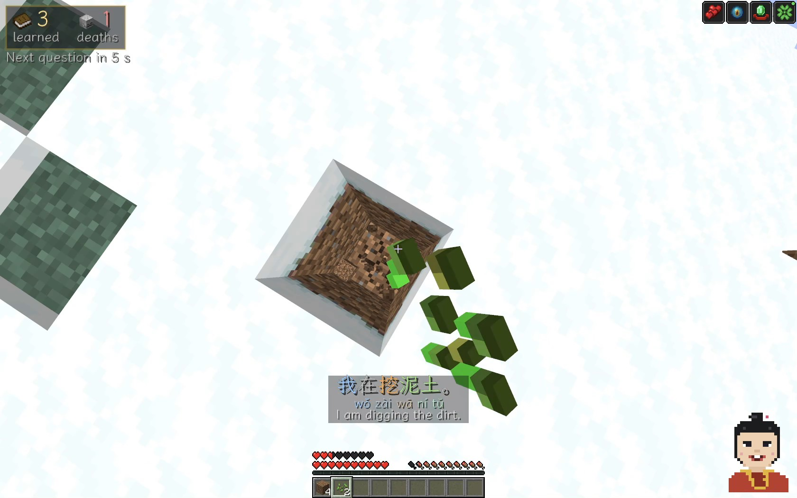
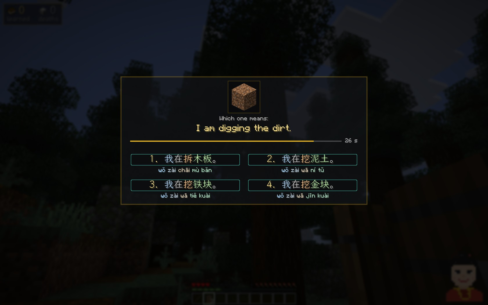
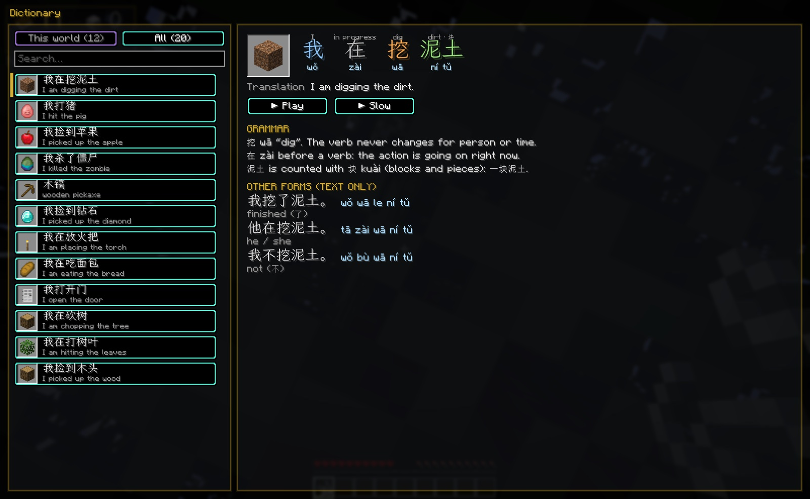
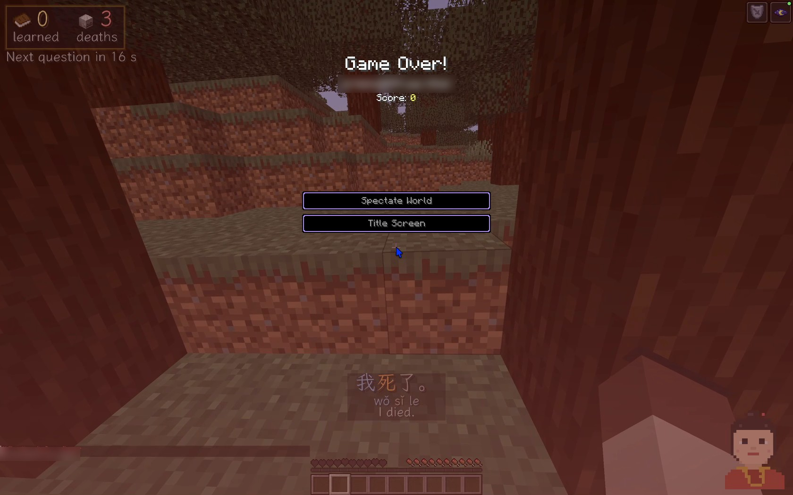

# Learn or Die: Language Teacher

**Learn English, Chinese, Japanese, Spanish, German, Portuguese or French while you play Minecraft.**

Your teacher watches what you do and says it out loud in the language you learn: 我在挖泥土 *wǒ zài wā ní tǔ* in Chinese, *Estoy cavando la tierra* in Spanish, *Ich grabe die Erde* in German, *Estou cavando a terra* in Portuguese, *Je creuse la terre* in French, 私は土を掘っています *watashi wa tsuchi o hotte imasu* in Japanese: "I am digging the dirt". The sentence shows up on screen with English (and pinyin for Chinese, romaji for Japanese), so you hear it, see it and understand it at the same time.

Then she quizzes you. Answer right and you get buffs. Answer wrong and you get debuffs. Three wrong answers in a row and she gets angry and empties your inventory. In a Hardcore world, one wrong answer is game over.

## Download

One file is the whole mod: pick your language and your Minecraft version. The same file works on Fabric and NeoForge, and Fabric API is inside.

| Language | Minecraft 26.3 | Minecraft 1.21.1 |
|---|---|---|
| Chinese (Mandarin) | [Download](https://github.com/Larenlearn/learn-or-die/releases/download/v0.4.7/learn-or-die-chinese-0.4.7+mc26.3.jar) | [Download](https://github.com/Larenlearn/learn-or-die/releases/download/v0.4.7/learn-or-die-chinese-0.4.7+mc1.21.1.jar) |
| Japanese | [Download](https://github.com/Larenlearn/learn-or-die/releases/download/v0.4.7/learn-or-die-japanese-0.4.7+mc26.3.jar) | [Download](https://github.com/Larenlearn/learn-or-die/releases/download/v0.4.7/learn-or-die-japanese-0.4.7+mc1.21.1.jar) |
| Spanish | [Download](https://github.com/Larenlearn/learn-or-die/releases/download/v0.4.7/learn-or-die-spanish-0.4.7+mc26.3.jar) | [Download](https://github.com/Larenlearn/learn-or-die/releases/download/v0.4.7/learn-or-die-spanish-0.4.7+mc1.21.1.jar) |
| German | [Download](https://github.com/Larenlearn/learn-or-die/releases/download/v0.4.7/learn-or-die-german-0.4.7+mc26.3.jar) | [Download](https://github.com/Larenlearn/learn-or-die/releases/download/v0.4.7/learn-or-die-german-0.4.7+mc1.21.1.jar) |
| Portuguese (Brazil) | [Download](https://github.com/Larenlearn/learn-or-die/releases/download/v0.4.7/learn-or-die-portuguese-0.4.7+mc26.3.jar) | [Download](https://github.com/Larenlearn/learn-or-die/releases/download/v0.4.7/learn-or-die-portuguese-0.4.7+mc1.21.1.jar) |
| English | [Download](https://github.com/Larenlearn/learn-or-die/releases/download/v0.4.7/learn-or-die-english-0.4.7+mc26.3.jar) | [Download](https://github.com/Larenlearn/learn-or-die/releases/download/v0.4.7/learn-or-die-english-0.4.7+mc1.21.1.jar) |
| French | [Download](https://github.com/Larenlearn/learn-or-die/releases/download/v0.4.7/learn-or-die-french-0.4.7+mc26.3.jar) | [Download](https://github.com/Larenlearn/learn-or-die/releases/download/v0.4.7/learn-or-die-french-0.4.7+mc1.21.1.jar) |

Several languages can be installed together. All versions are on the [Releases](https://github.com/Larenlearn/learn-or-die/releases) page.

The mod is also on CurseForge: [Learn Chinese](https://www.curseforge.com/minecraft/mc-mods/learn-or-die-chinese), [Learn Spanish](https://www.curseforge.com/minecraft/mc-mods/learn-or-die-spanish), [Learn German](https://www.curseforge.com/minecraft/mc-mods/learn-or-die-german), [Learn Portuguese](https://www.curseforge.com/minecraft/mc-mods/learn-or-die-portuguese), [Learn English](https://www.curseforge.com/minecraft/mc-mods/learn-or-die-english).

## What's inside

- **Seven languages.** English, Mandarin Chinese, Japanese, Spanish, German, Brazilian Portuguese and French, each in its own file. Install the ones you want and switch between them in the settings. The English teacher shows the translation in your own language, Spanish, Portuguese, German, Chinese or Japanese: pick it in the settings (I → Translations) or let the mod follow your game's language; without a translation the quiz is a listening one.
- **Thousands of spoken phrases** about what you do: mining, chopping trees, placing blocks, eating, fighting, sleeping, the weather and more (2,700+ in every language), 500+ words per language. Studio-quality voices that play offline, no account or API key.
- **Numbers the way people say them.** Pick up or hold a stack and the teacher counts it with the right grammar: 我捡到十四根木头, 私は原木を14本拾いました, Ich nehme vierzehn Stück Holz, Recogí veintiún diamantes, Peguei duas maçãs, J'ai ramassé vingt et une torches, I picked up fourteen apples.
- **The sentence on screen** with its English translation, Chinese with characters and pinyin, Japanese with its romaji. Words are coloured by their role in the sentence: pronoun, verb, object. Hold Right Shift to show pinyin.
- **Quizzes** about phrases the teacher has already said. Four answers in the language you learn: pick one with the keys 1–4 or the mouse. In singleplayer the world stops while you choose.
- **Rewards and punishments.** Regeneration, speed, haste, strength... or slowness, blindness, nausea, poison...
- **An angry teacher.** Three wrong answers in a row wipe your inventory. You can turn this off.
- **Hardcore.** In a Hardcore world one wrong answer kills you. With the English teacher it is the cowboy's revolver that does it.
- **Progress on screen.** Learned words and deaths are counted, for each language separately. A word you got right is learned: the teacher stops saying it in that world. In the settings you can make learned words come back after death or after an hour instead.
- **Dictionary.** Press J to see the phrases you have learned, with pictures, readings, translations, short grammar notes and other forms of each sentence, and hear them again, normal or slow. The notes follow your game's language.
- **Voice answers.** Answer by saying the phrase into your microphone: set Quiz to speech for spoken questions only, or to mixed. A free helper program listens on your own computer; you set it up with one click in the settings.
- **"What is this?"** Look at a block or creature and press V to hear its name.
- **Item names in the language you learn** in the tooltips.
- **Settings for everything:** speech speed, how often she talks and asks, what she talks about (walking and jumping only if you turn Movement on), answer time, penalties, text size and position.
- **A short guide** the first time you enter a world: keys, how often the teacher speaks, quizzes, buffs and debuffs, voice answers. Skip it and read it again any time: press U, or Settings → How it works….
- **Sound off, text on.** Press M when you do not want to hear the teacher: her phrases still appear, the quizzes still come and count. What you ask for is still spoken: the name of what you look at (V), a listening question, Play in the Dictionary.

## Controls

| Key | What it does |
|---|---|
| N | Teacher on / off |
| Right Shift (hold) | Show pinyin |
| V | Say the name of the block or creature you are looking at |
| K | Normal / slow speech |
| M | Teacher's sound off / on (the text and the quizzes stay) |
| U | The guide: how the mod works |
| J | Dictionary of the phrases you have learned |
| I | Settings |
| 1–4 or mouse | Answer a question |
| B (hold) | Answer a spoken question |

You can change every key in Options → Controls → Key Binds → Learn or Die: Language Teacher.

## How to install

Download the file of the language you want for your Minecraft version, 1.21.1 or 26.3 (see [Download](#download)). That one file is the whole mod: Learn or Die and, for Fabric, Fabric API are inside.

**Fabric**

1. Download the [Fabric installer](https://fabricmc.net/use/installer/), open it, choose Minecraft **1.21.1** or **26.3** and click **Install**.
2. Put the language file into the `mods` folder (see below).
3. Open the Minecraft Launcher, pick the **fabric-loader** profile of your version and press **Play**.

**NeoForge**

1. Download the [NeoForge installer](https://neoforged.net/) for your Minecraft version (**1.21.1** or **26.3**), open it and install the client.
2. Put the language file into the `mods` folder. Nothing else is needed.
3. Open the Minecraft Launcher, pick the **NeoForge** profile and press **Play**.

The `mods` folder (create it if it does not exist):
- Windows: `%appdata%\.minecraft\mods`
- macOS: `~/Library/Application Support/minecraft/mods`
- Linux: `~/.minecraft/mods`

**With the CurseForge App:** create a profile with Minecraft 1.21.1 or 26.3 and the Fabric or NeoForge loader, find Learn Chinese, Learn Spanish, Learn German or Learn Portuguese in the app and add it.

Settings: press I in the game. They also open from the mod list: on NeoForge from the built-in Mods screen, on Fabric with [Mod Menu](https://www.curseforge.com/minecraft/mc-mods/modmenu) (optional). The **Language** setting switches between the installed languages.

## Voice answers

1. Open the settings (I) and press **Voice answers: set up…**, then **Yes**.
2. A helper window opens. The first start downloads about 1.5 GB (Python, PyTorch and a speech recognition model) into `.minecraft/learn-or-die` and takes a few minutes. Keep the window open.
3. When the chat says the voice answers are ready, spoken questions appear at the top of the screen: hold **B** and say the phrase.

From then on the helper starts with the game by itself and closes when you quit.

**Switching languages.** Every language has its own speech model. The first time you choose a language, its model downloads once (about 1.2 GB, a minute or two). After that, switching takes 10–15 seconds while the model loads. You see how far it is in the top left corner; spoken questions come back when it is ready.

- **Private.** Your voice is recognised on your computer and never leaves it.
- **Systems:** Windows 10 or 11 (64-bit), Linux, or a Mac with Apple Silicon and macOS 14 or newer. About 3 GB of free disk space, plus 1.3 GB for each more language; 8 GB of RAM recommended.
- **Mac:** allow Terminal to use the microphone when macOS asks.
- **Windows:** if the helper window shows an error about a missing DLL, install the Microsoft Visual C++ Redistributable (x64).
- **Linux:** the helper needs PortAudio, for example `sudo apt install libportaudio2`.
- **Uninstall:** delete the `learn-or-die` folder inside your `.minecraft` folder.
- **Beta.** Voice answers are new. If the helper does not start on your computer, please [open an issue](https://github.com/Larenlearn/learn-or-die/issues).

## Good to know

- **Singleplayer.** Rewards, punishments and the angry teacher only work in singleplayer. On a server the teacher still talks and asks questions, but nothing happens to you.
- **Client-side.** Install it in your own game only, not on a server.
- **No internet needed to play.** All the teacher's speech is inside the language file, which is why each is 80–185 MB. Only the voice answers setup downloads once.
- **No punishments:** Settings → Penalty → none.
- **Keep your inventory safe:** Settings → Advanced settings → Angry after N wrong → 0.
- **More languages are planned.** Tell me which one you want next in the comments under my videos (links below)!
- **Found a bug or have an idea?** [Open an issue](https://github.com/Larenlearn/learn-or-die/issues).

## Follow me

Updates, new languages and videos:

- [CurseForge](https://www.curseforge.com/minecraft/mc-mods/learn-or-die)
- [YouTube](https://www.youtube.com/@LadenBed90)
- [TikTok](https://www.tiktok.com/@laden_bed)
- [Instagram](https://www.instagram.com/laden_bed/)
- [X (Twitter)](https://x.com/LadenBed94)

## Credits

- Made by Laren.
- Fonts: [LXGW WenKai](https://github.com/lxgw/LxgwWenKai) (Chinese) and [Klee One](https://github.com/fontworks-fonts/Klee) (Japanese), SIL Open Font License 1.1.
- Each file bundles [Fabric API](https://github.com/FabricMC/fabric) (Apache License 2.0).
- License: [MIT](LICENSE).
